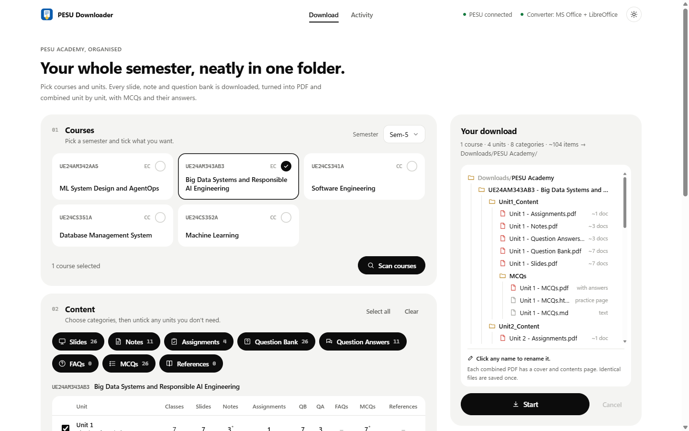
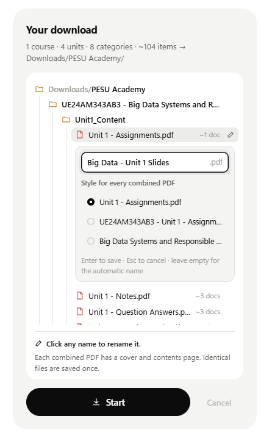
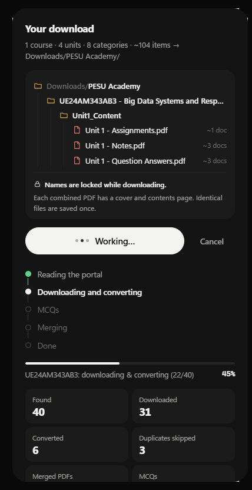
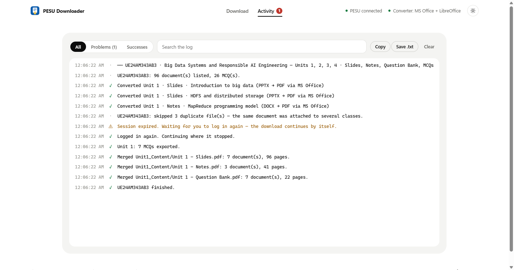
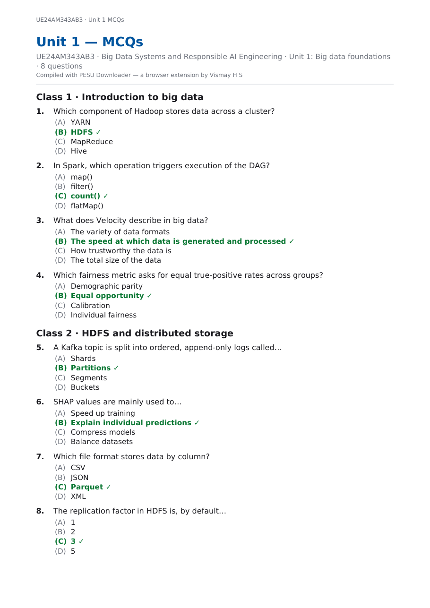
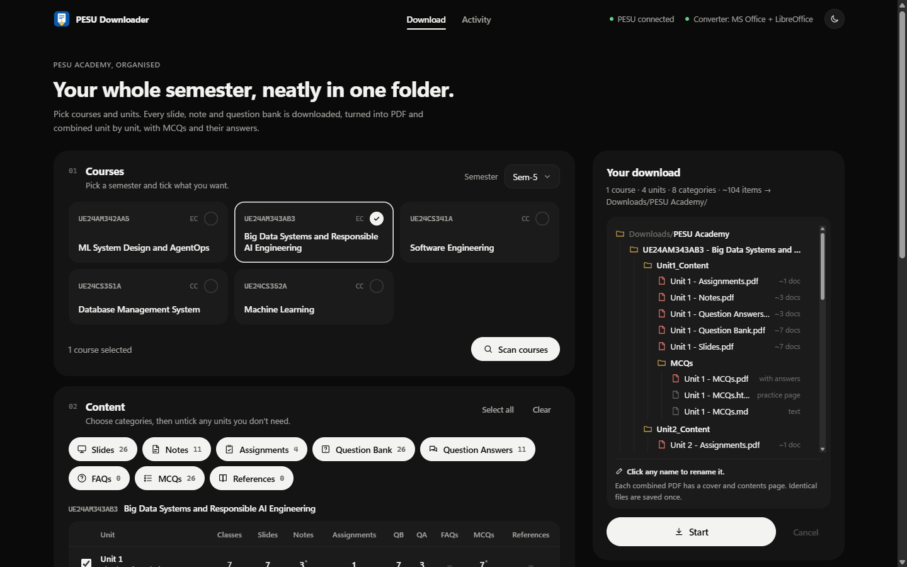
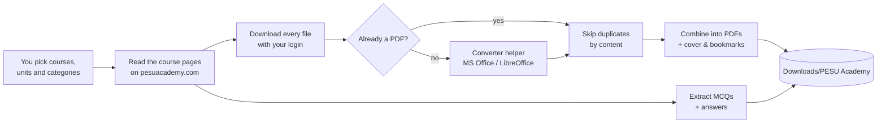

<div align="center">


# PESU Downloader

**Your whole semester from [PESU Academy](https://www.pesuacademy.com), neatly in one folder.**

Download slides, notes, question banks and MCQs unit by unit. Convert everything to PDF, combine it into bookmarked PDFs and get the MCQs with their answers. One click.

Made by **Vismay H S**

[](https://github.com/VismayHS/Pesu_Merger/stargazers)
&nbsp;

&nbsp;


</div>

> [!TIP]
> **Did this save you time? Please ⭐ star the repository** ([click here](https://github.com/VismayHS/Pesu_Merger), then press **Star** at the top right). It's free, takes one second, and helps other PES students find the tool.

<p align="center">
  
</p>

---

## Contents

- [What you get](#what-you-get)
- [Before you start](#before-you-start)
- [Install (about 15 minutes)](#install-about-15-minutes)
  - [1. Install Python and Office or LibreOffice](#1-install-python-and-office-or-libreoffice)
  - [2. Download PESU Downloader](#2-download-pesu-downloader)
  - [3. Add the extension to your browser](#3-add-the-extension-to-your-browser)
  - [Using Firefox?](#using-firefox)
  - [4. Connect the converter](#4-connect-the-converter)
  - [5. Check that everything is ready](#5-check-that-everything-is-ready)
- [How to use it](#how-to-use-it)
- [Rename anything](#rename-anything)
- [While it runs](#while-it-runs)
- [What the PDFs look like](#what-the-pdfs-look-like)
- [MCQs](#mcqs)
- [Options explained](#options-explained)
- [How it works](#how-it-works)
- [Privacy and permissions](#privacy-and-permissions)
- [Troubleshooting](#troubleshooting)
- [Help, ideas and contact](#help-ideas-and-contact)
- [For developers](#for-developers)
- [Credits](#credits)

---

## What you get

A tidy folder in your **Downloads**, with one folder per course and one folder per unit:

```text
Downloads/
└── PESU Academy/
    └── UE24AM343AB3 - Big Data Systems and Responsible AI Engineering/
        ├── Unit1_Content/
        │   ├── Unit 1 - Slides.pdf            ← all of Unit 1's slides, in class order
        │   ├── Unit 1 - Notes.pdf
        │   ├── Unit 1 - Question Bank.pdf
        │   ├── MCQs/
        │   │   ├── Unit 1 - MCQs.pdf          ← questions with the answers marked
        │   │   ├── Unit 1 - MCQs.html         ← interactive practice page
        │   │   └── Unit 1 - MCQs.md
        │   └── Files/                         ← only if you ask for separate files
        │       └── Slides/01 - Introduction to big data.pdf
        ├── Unit2_Content/
        │   └── …
        └── _Report.txt                        ← what was saved, and anything that failed
```

- **Any file type.** PDF, PPTX, PPT, DOCX, DOC, XLSX, ODP, ODT, RTF, images and text all become PDF.
- **Combined PDFs** have a cover page, a clickable list of topics and bookmarks.
- **MCQs come with answers**, as a PDF, an interactive practice page, Markdown or JSON.
- **No duplicates.** A file attached to several classes is saved once (checked by content, not by name).
- **It doesn't give up.** If your session expires, the internet drops or PESU is slow, it waits and carries on by itself.
- **Light and dark mode**, with a toggle in the top-right corner.
- It runs **only on pesuacademy.com** and sends nothing anywhere else.

---

## Before you start

**New to this? No problem.** You don't need to know any coding, and you don't need git, a terminal or a GitHub account. Here's everything you need:

| What | Notes |
|---|---|
| 💻 **A laptop or desktop** with Windows, macOS or Linux | Phones and tablets can't run extensions like this. |
| 🌐 **A supported browser:** Chrome, Edge, Brave, Firefox, Vivaldi or Arc | **Windows already has Edge.** On a Mac, install [Chrome](https://www.google.com/chrome/) for free. **Safari is not supported.** |
| 🔑 **Your PESU Academy login** | The extension uses the login of the browser it's installed in, so log in to pesuacademy.com in that browser. |
| 📊 **Microsoft Office or LibreOffice** (LibreOffice is free) and **Python** (free) | Needed to turn PowerPoint and Word files into PDF, and most PESU courses have them. Don't have them? [Step 1](#1-install-python-and-office-or-libreoffice) shows how to install them. |
| ⏱️ **About 15 minutes** and an internet connection | A bit longer if you need to download LibreOffice. |

<details>
<summary><b>Never unzipped a file or found your Downloads folder? Read this first.</b></summary>

- **Downloads folder:**
  - On Windows, open **File Explorer** (the yellow folder icon on the taskbar, or press <kbd>Win</kbd> + <kbd>E</kbd>) and click **Downloads** on the left.
  - On a Mac, open **Finder** and click **Downloads** in the sidebar.
- **Unzipping (extracting) a ZIP file:**
  - On Windows, right-click the `.zip` file, choose **Extract All…**, then **Extract**.
  - On a Mac, just double-click the `.zip` file.
  - You get a normal folder, here called `Pesu_Merger-main`. Use that folder, not the `.zip`.
- **Moving a folder:** drag it onto **Documents** in the sidebar, or right-click it, **Cut**, open Documents and **Paste**.
- **Typing an address like `chrome://extensions`:** click the bar at the top of the browser where website addresses go, type it exactly and press <kbd>Enter</kbd>.
- **The `extension` folder** is the one that has a file called `manifest.json` inside it. That's the folder the browser asks for.

</details>

---

## Install (about 15 minutes)

Works in **Chrome, Edge, Brave, Chromium, Vivaldi, Arc and Firefox**, on **Windows, macOS and Linux**. Firefox has a few different steps: [see below](#using-firefox).

> [!IMPORTANT]
> **Do all five steps, in order.** Don't skip step 1. Most courses share slides as PowerPoint and notes as Word files. Without Office or LibreOffice, those are only saved as they are and are left out of your combined PDFs.

> [!WARNING]
> **Safari is not supported.** Apple only allows Safari extensions that are built with Xcode on a Mac and signed with a paid Apple developer account. **On a Mac, use Chrome, Edge, Brave or Firefox for PESU downloads** and keep Safari for everything else. Opera may work but isn't tested.

### 1. Install Python and Office or LibreOffice

The extension uses these to turn PowerPoint and Word files into PDF. Both are free (except Microsoft Office). Skip any part you already have.

> [!TIP]
> **Shortcut:** the installer in [step 4](#4-connect-the-converter) checks for all of this and offers to install anything that's missing. On Windows it can install both Python and LibreOffice for you. So if this step feels like a lot, go straight to step 2 and let the installer handle it.

<details open>
<summary><b>🪟 Windows</b></summary>

**a) Python**

1. Go to **[python.org/downloads](https://www.python.org/downloads/)** and click the big yellow **Download Python 3.x** button.
2. Open the downloaded file.
3. ⚠️ **On the first screen, tick "Add python.exe to PATH"** at the bottom. This is important.
4. Click **Install Now**. When it says *Setup was successful*, click **Close**.

Install it from python.org, not from the Microsoft Store.

**b) Microsoft Office or LibreOffice**

- **Already have Microsoft Office?** Press the <kbd>Win</kbd> key and type **PowerPoint**. If PowerPoint shows up, you're done: skip to step 2. (The installed app is needed. Office in the browser doesn't count.)
- **No Office?** Install **LibreOffice**. It's free:
  1. Go to **[libreoffice.org/download](https://www.libreoffice.org/download/download-libreoffice/)** and click **Download** (it picks Windows for you).
  2. Open the downloaded file and click **Next** through the setup with the default options, then **Install**.
  3. If Windows asks *"Do you want to allow this app to make changes?"*, click **Yes**.

</details>

<details>
<summary><b>🍎 macOS</b></summary>

On a Mac the converter uses **LibreOffice**, even if you have Microsoft Office, so install LibreOffice either way.

**a) Python:** go to **[python.org/downloads](https://www.python.org/downloads/)**, click **Download Python 3.x**, open the downloaded file and click **Continue** → **Install**.

**b) LibreOffice:**

1. Check your Mac's chip: Apple menu  → **About This Mac**. It says either **Chip: Apple M…** or **Processor: Intel**.
2. Go to **[libreoffice.org/download](https://www.libreoffice.org/download/download-libreoffice/)** and choose **macOS (Apple Silicon)** for an M chip, or **macOS x86_64** for Intel. Then click **Download**.
3. Open the downloaded file and **drag LibreOffice into the Applications folder**.

Use Homebrew? Then `brew install python` and `brew install --cask libreoffice` do the same.

</details>

<details>
<summary><b>🐧 Linux</b></summary>

The converter uses **LibreOffice** on Linux.

```bash
sudo apt install python3 libreoffice      # Fedora: sudo dnf install python3 libreoffice
```

</details>

### 2. Download PESU Downloader

**Option A (easiest, no git needed):**

1. Near the top of this page, click the green **`<> Code`** button.
2. Click **Download ZIP**. It's saved to your **Downloads** folder.
3. Unzip it ([how?](#before-you-start)). You get a folder called **`Pesu_Merger-main`**.
4. Move that folder into **Documents** (or anywhere you won't delete it by accident).

**Option B (if you use git):**

```bash
git clone https://github.com/VismayHS/Pesu_Merger.git
```

> [!IMPORTANT]
> Keep the folder somewhere permanent, such as **Documents**. The browser loads the extension from this folder, so it stops working if you delete or move the folder.

### 3. Add the extension to your browser

1. Open the extensions page. Type one of these into the address bar:

   | Browser | Address |
   |---|---|
   | Chrome / Chromium / Arc | `chrome://extensions` |
   | Brave | `brave://extensions` |
   | Edge | `edge://extensions` |
   | Vivaldi | `vivaldi://extensions` |

2. Turn on **Developer mode**. It's a switch in the top-right corner; in Edge it's in the left sidebar. This only lets you add extensions from a folder. It's safe, and it doesn't change anything else.
3. Click **Load unpacked**.
4. In the window that opens, go into the project folder (`Pesu_Merger-main`), click the **`extension`** folder once to select it, and press **Select Folder**. Choose that folder itself, not the outer `Pesu_Merger-main` folder.
5. **PESU Downloader** now appears in the list. Click the puzzle-piece icon 🧩 in the toolbar and **pin** it so it's always one click away.

If the browser later shows a message about "developer mode extensions", just close it or click **Keep**. That's normal for extensions added this way.

### Using Firefox?

Firefox works too (version 128 or newer), but it adds extensions differently. Do this instead of step 3:

1. In Firefox, type **`about:debugging#/runtime/this-firefox`** in the address bar and press <kbd>Enter</kbd>.
2. Click **Load Temporary Add-on…**.
3. Go into the project folder, open the **`extension`** folder and pick the file **`manifest.json`**.
4. If a banner on the PESU Downloader page asks for access to pesuacademy.com, click **Allow access**.

> [!NOTE]
> Firefox removes **temporary** add-ons when you close it, so you'll need to repeat these steps each time you start Firefox. They take about 10 seconds. If you'd rather not, use Chrome, Edge or Brave, where it stays installed.

### 4. Connect the converter

The installer does everything in one go:

- It checks for **Python** and for **Microsoft Office or LibreOffice**.
- If something is missing, it asks *"Install it now? [Y/n]"*. Press <kbd>Enter</kbd> to say yes, and it installs it for you. LibreOffice is about a 350 MB download.
- It connects the extension to every supported browser on your computer, Firefox included, then tests that everything works.

<details open>
<summary><b>🪟 Windows</b></summary>

1. Open the project folder (`Pesu_Merger-main`), then the **`native-host`** folder.
2. **Double-click `install.bat`**. If Windows asks whether to run it, click **Run**. If it says *"Windows protected your PC"*, click **More info** → **Run anyway**.
3. A black window shows what it found. If it asks to install Python or LibreOffice, press <kbd>Enter</kbd>. For LibreOffice, Windows asks *"Do you want to allow this app to make changes?"*: click **Yes**.
4. When it says **ALL SET!**, press any key to close the window.

</details>

<details>
<summary><b>🍎 macOS</b></summary>

1. Open **Terminal**: press <kbd>⌘</kbd> + <kbd>Space</kbd>, type **Terminal** and press <kbd>Enter</kbd>.
2. Type `bash` followed by a space. **Don't press Enter yet.**
3. In Finder, open the project folder, then **`native-host`**, and **drag the file `install.sh` into the Terminal window**. Its location appears after `bash `.
4. Press <kbd>Enter</kbd>. When it says **ALL SET!**, you can close Terminal.

If you use Homebrew, the installer can install Python and LibreOffice for you. Without Homebrew, it opens the right download page and tells you what to click.

</details>

<details>
<summary><b>🐧 Linux</b></summary>

From the project folder:

```bash
bash native-host/install.sh
```

It can install Python and LibreOffice with apt, dnf, pacman or zypper. It asks for your password first.

A **Snap or Flatpak** browser can't start local helpers. Use the `.deb`/`.rpm` build of Chrome, Brave or Edge.

</details>

**It says NOT FINISHED?** Something is still missing, and the window tells you exactly what to do. Usually that's installing Python or LibreOffice from the page it opened for you, then running the installer again.

> Moved the project folder later? Run the installer again. To remove the converter, run `native-host\uninstall.bat` (Windows) or `bash native-host/uninstall.sh` (macOS/Linux).

### 5. Check that everything is ready

Restart your browser once, then open **PESU Downloader** by clicking its icon. The top-right corner should say **Converter: MS Office** or **Converter: LibreOffice** (or both). 🎉 You're ready: see [How to use it](#how-to-use-it).

If a banner says **Set up the converter** or **Install LibreOffice**, press **Re-check**. If it still shows, see [Troubleshooting](#troubleshooting). If you press **Start** while the converter isn't ready, the extension warns you first, so you can set it up or choose **Start anyway**.

---

## How to use it

1. **Log in** to [pesuacademy.com](https://www.pesuacademy.com) in the same browser.
2. **Open the extension:** click its icon, or the **⬇ PESU Downloader** button that appears on PESU pages.
3. **Courses:** pick a semester, tick the courses you want and press **Scan courses**.
4. **Content:** pick the categories (Slides, Notes, Assignments, Question Bank, Question Answers, FAQs, MCQs, References), then untick any units you don't need. The table shows how many files each unit has.

   

5. **Output:** choose how files are combined, plus a few extras ([explained below](#options-explained)).

   

6. Check the **Your download** panel on the right. It shows exactly which folders and files you'll get.
7. Press **Start**. Keep the tab open until it says **All done**, then press **Open folder**.

---

## Rename anything

Don't like a name? **Click it in the "Your download" panel and type a new one.**

<p align="center"></p>

- **Enter** saves, **Esc** cancels, and an empty name brings back the automatic one.
- Under the name field there are **styles that apply to every item of that kind**, for example `UE24AM343AB3 - Unit 1 - Slides.pdf` for all combined PDFs.
- Renamed items show a **↺** button that puts the automatic name back. **Reset names** at the bottom resets everything.
- You can rename the main folder, course folders, unit folders (`Unit1_Content`), combined PDFs and MCQ files. Separate files are named after their class, and you pick a style for them.
- Names are **locked once you press Start**, so the download stays consistent. Press **Cancel** if you want to change something.

---

## While it runs

<p align="center">
  
  &nbsp;&nbsp;
  
</p>

- The steps on the left show where it is: reading the portal, downloading and converting, MCQs, combining.
- **Cancel** stops cleanly. Files that are half-way finish first, and everything saved so far is kept.
- **Your session expired?** A banner asks you to log in again. Log in on any PESU tab and the download **continues by itself** from where it stopped.
- **Internet dropped?** It waits until you're back online.
- **PESU slow or busy?** It retries, and has two backup ways to download a file.
- The **Activity** tab has the full log, with a "Problems" filter, search, copy and save:

<p align="center"></p>

---

## What the PDFs look like

Every combined PDF starts with a cover page. It says where the material came from and lists every topic with its page number. **Click a topic to jump to it.** The same list is in the PDF's bookmarks sidebar.

<p align="center">
  
</p>

## MCQs

MCQs are saved per unit, in that unit's `MCQs` folder, with the correct answers taken from the portal.

| PDF (answers marked) | Practice page (click an answer to check it) |
|---|---|
|  |  |

- **Answers** can be marked next to each question, listed as a key at the end, both, or hidden (good for revision).
- The **practice page** opens in any browser. It keeps your score, and has **Shuffle**, **Reset** and **Show all answers** buttons.
- Images and equations inside questions are kept.

---

## Options explained

| Option | What it does |
|---|---|
| **Per unit and category** *(default)* | One PDF per category in each unit: `Unit 1 - Slides.pdf`, `Unit 1 - Notes.pdf`… |
| **Per category** | One PDF per category across all units: `Slides - Units 1-4.pdf` |
| **Per unit** | Everything for a unit in one PDF: `Unit 1 - Complete.pdf` |
| **One single PDF** | All selected material in one file |
| **Don't merge** | Just the individual files, each converted to PDF |
| **Cover and contents page** | The clickable topic list at the start of every combined PDF |
| **Divider before each document** | A title page before each document, naming its class |
| **Keep separate files too** | Also saves every document as its own PDF in `UnitN_Content/Files/<Category>/` |
| **Keep original PPT / DOC** | Also keeps the original Office files next to the PDFs |
| **MCQ answers** | Marked / key at end / both / hidden |
| **MCQ formats** | PDF, practice page (HTML), Markdown, JSON |
| **Folder inside Downloads** | The main folder name (default `PESU Academy`) |
| **Converter** | Automatic (MS Office, then LibreOffice), or force one of them |

If an option doesn't apply to your choice, it's greyed out. For example, the cover page does nothing when files aren't combined. The panel on the right always shows the real result.

<details>
<summary><b>Prefer the dark theme?</b></summary>

The page follows your system's light/dark setting. Use the ☀/☾ button in the top-right corner to switch, and it will remember your choice.



</details>

---

## How it works



Everything happens inside your browser and on your own computer. The extension uses your existing PESU login, exactly like you clicking each file by hand, only faster and organised.

---

## Privacy and permissions

The extension talks **only** to `pesuacademy.com` and its file server `files.pesuacademy.com`. No analytics, no servers, and your password is never touched.

| Permission | Why it's needed |
|---|---|
| `pesuacademy.com`, `files.pesuacademy.com` | Read course pages and download files with your login |
| `downloads`, `downloads.ui` | Save files into Downloads (the download bubble is hidden during a run) |
| `scripting`, `webRequest` | Backup route: fetch through your open PESU tab if direct requests are blocked |
| `nativeMessaging` | Talk to the optional converter helper on your computer |
| `storage`, `unlimitedStorage` | Remember your settings and handle large files |

---

## Troubleshooting

<details>
<summary><b>"Set up the converter" or "Install LibreOffice" keeps showing</b></summary>

- Run the installer for your system ([step 4](#4-connect-the-converter)) and read its last line. **ALL SET!** means it worked: restart the browser once and press **Re-check**. **NOT FINISHED** tells you what's still missing.
- Check what the installer would do without changing anything: `native-host\install.bat -DryRun` (Windows) or `bash native-host/install.sh --dry-run` (macOS/Linux).
- Linux: Snap/Flatpak browsers can't run helpers. Use the `.deb`/`.rpm` version of the browser.

</details>

<details>
<summary><b>The ⬇ PESU Downloader button on pesuacademy.com doesn't respond</b></summary>

- After you reload or update the extension, the button in already-open PESU tabs is replaced with a fresh one automatically, so it keeps working.
- If it ever says **↻ Refresh page to use PESU Downloader**, click it once: the page refreshes and the button works again.
- The toolbar icon (puzzle piece → PESU Downloader) always works too.

</details>

<details>
<summary><b>Windows: "Python was not found"</b></summary>

Install Python from [python.org](https://www.python.org/downloads/) with **Add to PATH** ticked. The Microsoft Store shortcut doesn't work. Then run `install.bat` again.

</details>

<details>
<summary><b>"Log in to PESU Academy"</b> keeps showing</summary>

Log in at pesuacademy.com **in the same browser and profile**. The extension notices by itself within a few seconds. You can also press **Continue**.

</details>

<details>
<summary><b>A PowerPoint file failed to convert</b></summary>

The helper tries MS Office first, then LibreOffice. If both fail, the original file is saved instead and listed in `_Report.txt`.

</details>

<details>
<summary><b>macOS: LibreOffice is installed but not found</b></summary>

It must be in `/Applications/LibreOffice.app`. Move it there and run `install.sh` again.

</details>

<details>
<summary><b>Where is the helper's log?</b></summary>

- Windows: `%LOCALAPPDATA%\PESUDownloader\host.log`
- macOS: `~/Library/Application Support/PESUDownloader/host.log`
- Linux: `~/.cache/pesu-downloader/host.log`

</details>

<details>
<summary><b>How do I update to a new version?</b></summary>

Download the new code (or `git pull`), then press the **reload ↻** button on the extension's card in `chrome://extensions`. In Firefox, press **Reload** next to PESU Downloader on the `about:debugging` page. Run the helper installer again only if you moved the folder.

</details>

<details>
<summary><b>Firefox: PESU Downloader disappeared</b></summary>

Firefox removes temporary add-ons when it closes. Load it again from `about:debugging#/runtime/this-firefox` → **Load Temporary Add-on…** → `extension/manifest.json` ([details](#using-firefox)).

</details>

Still stuck? See [Help, ideas and contact](#help-ideas-and-contact).

---

## Help, ideas and contact

Found a bug, or have an idea? You're very welcome to tell me.

| | How |
|---|---|
| 🐞 **Something isn't working** | [Open a bug report](https://github.com/VismayHS/Pesu_Merger/issues/new?template=bug_report.yml). Paste the **Activity** log (Activity tab → **Copy**) and say which browser and OS you use. |
| 💡 **Idea or feature request** | [Suggest a feature](https://github.com/VismayHS/Pesu_Merger/issues/new?template=feature_request.yml) |
| 🔎 **Already reported?** | [Browse open issues](https://github.com/VismayHS/Pesu_Merger/issues) and add a 👍 to the ones that affect you |
| ✉️ **Prefer email?** | Write to **[vismayhs@gmail.com](mailto:vismayhs@gmail.com)** |

Opening an issue needs a free GitHub account. Please never share your PESU password or SRN in an issue.

---

## For developers

| Path | Role |
|---|---|
| `extension/app.html`, `app.css`, `app.js` | The downloader page: UI, naming and inline rename, preview, job pipeline, dedupe, session watchdog |
| `extension/src/pesu.js` | Portal endpoints and HTML parsers (semesters, courses, units, classes, content, MCQs) |
| `extension/src/net.js` | Page and file fetching with session detection, retries and fallback routes |
| `extension/src/pdf.js` | Merging with pdf-lib: cover and contents page, bookmarks, image/text → PDF, MCQ PDF |
| `extension/src/mcq.js` | MCQ layout and the HTML / Markdown / JSON exports |
| `extension/src/native.js` | Chunked native-messaging client for the helper |
| `extension/src/fx.js`, `theme.js` | Small UI effects; light / dark switch |
| `native-host/pesu_host.py` | The helper (Python standard library only): MS Office COM on Windows, LibreOffice everywhere, PDF repair |
| `native-host/install.*`, `uninstall.*` | One-step setup: finds or installs Python and Office/LibreOffice (winget / Homebrew / apt…), registers the helper per user (Windows registry, macOS/Linux manifest folders) and tests it. `-DryRun` / `--dry-run` changes nothing, `-Yes` / `--yes` doesn't ask |
| `native-host/selftest.py` | Used by the installers: asks the helper what converters it found |

```bash
# Helper test (run the installer first): converts every Office file in a folder
node tests/host_test.js <folder with office files>

# PDF engine test: merge, cover page, MCQ layout
npm install --no-save pdf-lib@1.17.1 @pdf-lib/fontkit@1.1.1
node tests/pdf_test.js <folder with PDFs + tiny.png> <out folder>
```

After editing anything in `extension/`, press **Reload** on the extension card. The extension ID is always `cooigkfjkkbolfcfcdmbmdjpmbmlofab` (fixed by the key in `manifest.json`), which the helper relies on.

---

## Credits

Built by **Vismay H S**.

Bundled third-party code: [pdf-lib](https://github.com/Hopding/pdf-lib) (MIT), [@pdf-lib/fontkit](https://github.com/Hopding/fontkit) (MIT) and the DejaVu fonts (free license, see `extension/fonts/LICENSE-DejaVu.txt`).

This is an unofficial student tool, not affiliated with PES University. Use it only for material your account has access to.

<div align="center">

**If PESU Downloader helped you, please [⭐ star the repo](https://github.com/VismayHS/Pesu_Merger) and share it with your classmates!**

</div>
