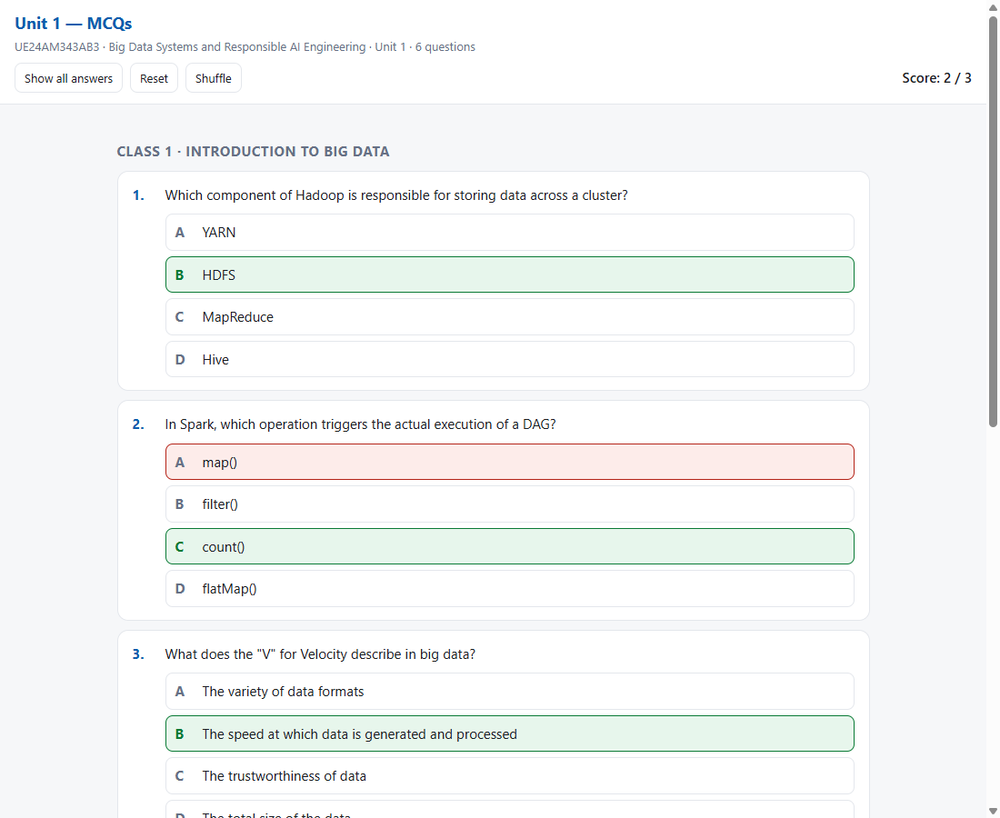
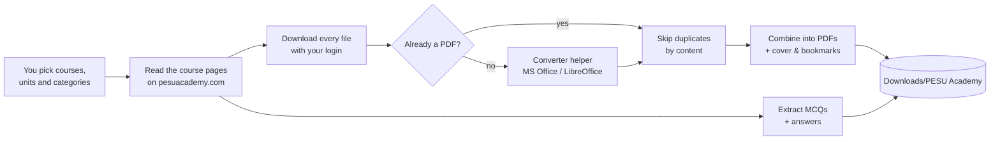

<div align="center">


# PESU Downloader

**Your whole semester from [PESU Academy](https://www.pesuacademy.com), neatly in one folder.**

Download slides, notes, question banks and MCQs unit by unit. Convert everything to PDF, combine it into bookmarked PDFs and get the MCQs with their answers. One click.

Made by **Vismay H S**

[](https://github.com/VismayHS/Pesu_Merger/stargazers)
&nbsp;

&nbsp;


</div>

> [!TIP]
> **Did this save you time? Please ⭐ star the repository** ([click here](https://github.com/VismayHS/Pesu_Merger), then press **Star** at the top right). It's free, takes one second, and helps other PES students find the tool.

<p align="center">
  
</p>

---

## Contents

- [What you get](#what-you-get)
- [Before you start](#before-you-start)
- [Install (about 5 minutes)](#install-about-5-minutes)
  - [1. Download PESU Downloader](#1-download-pesu-downloader)
  - [2. Add it to your browser](#2-add-it-to-your-browser) ([Firefox](#using-firefox))
  - [3. Run the installer](#3-run-the-installer)
  - [4. Open it and check](#4-open-it-and-check)
- [How to use it](#how-to-use-it)
- [Rename anything](#rename-anything)
- [While it runs](#while-it-runs)
- [What the PDFs look like](#what-the-pdfs-look-like)
- [MCQs](#mcqs)
- [Options explained](#options-explained)
- [How it works](#how-it-works)
- [Privacy and permissions](#privacy-and-permissions)
- [Troubleshooting](#troubleshooting)
- [Help, ideas and contact](#help-ideas-and-contact)
- [For developers](#for-developers)
- [Credits](#credits)

---

## What you get

A tidy folder in your **Downloads**, with one folder per course and one folder per unit:

```text
Downloads/
└── PESU Academy/
    └── UE24AM343AB3 - Big Data Systems and Responsible AI Engineering/
        ├── Unit1_Content/
        │   ├── Unit 1 - Slides.pdf            ← all of Unit 1's slides, in class order
        │   ├── Unit 1 - Notes.pdf
        │   ├── Unit 1 - Question Bank.pdf
        │   ├── MCQs/
        │   │   ├── Unit 1 - MCQs.pdf          ← questions with the answers marked
        │   │   ├── Unit 1 - MCQs.html         ← interactive practice page
        │   │   └── Unit 1 - MCQs.md
        │   └── Files/                         ← only if you ask for separate files
        │       └── Slides/01 - Introduction to big data.pdf
        ├── Unit2_Content/
        │   └── …
        └── _Report.txt                        ← what was saved, and anything that failed
```

- **Any file type.** PDF, PPTX, PPT, DOCX, DOC, XLSX, ODP, ODT, RTF, images and text all become PDF.
- **Combined PDFs** have a cover page, a clickable list of topics and bookmarks.
- **MCQs come with answers**, as a PDF, an interactive practice page, Markdown or JSON.
- **No duplicates.** A file attached to several classes is saved once (checked by content, not by name).
- **It doesn't give up.** If your session expires, the internet drops or PESU is slow, it waits and carries on by itself.
- **Light and dark mode**, with a toggle in the top-right corner.
- It runs **only on pesuacademy.com** and sends nothing anywhere else.

---

## Before you start

**No coding needed.** You don't need git, a GitHub account or anything installed beforehand.

| You need | Notes |
|---|---|
| 💻 **A laptop or desktop** with Windows, macOS or Linux | Phones and tablets can't run extensions like this. |
| 🌐 **Chrome, Edge, Brave, Firefox, Vivaldi or Arc** | Windows already has Edge. **Safari isn't supported** (Apple only allows paid, Xcode-built Safari extensions), so on a Mac use Chrome or Firefox. |
| 🔑 **Your PESU Academy login** | Log in to pesuacademy.com in the browser you add the extension to. |
| ⏱️ **About 5 minutes** | Longer if the installer has to download Python or LibreOffice (LibreOffice is about 350 MB). |

<details>
<summary><b>Never unzipped a file or found your Downloads folder? Read this first.</b></summary>

- **Downloads folder:** on Windows, open **File Explorer** (<kbd>Win</kbd> + <kbd>E</kbd>) and click **Downloads** on the left. On a Mac, open **Finder** and click **Downloads** in the sidebar.
- **Unzipping a ZIP file:** on Windows, right-click it → **Extract All…** → **Extract**. On a Mac, double-click it. Use the folder you get, not the `.zip`.
- **Moving a folder:** drag it onto **Documents** in the sidebar.
- **Typing an address like `chrome://extensions`:** click the bar at the top of the browser where website addresses go, type it exactly and press <kbd>Enter</kbd>.

</details>

---

## Install (about 5 minutes)

Four steps, in order. Works on **Windows, macOS and Linux**.

### 1. Download PESU Downloader

1. Near the top of this page, click the green **`<> Code`** button, then **Download ZIP**.
2. Unzip it ([how?](#before-you-start)). You get a folder called **`Pesu_Merger-main`**.
3. Move that folder into **Documents** and leave it there. The browser loads the extension from this folder, so it stops working if you delete or move it.

Use git? `git clone https://github.com/VismayHS/Pesu_Merger.git` works too.

### 2. Add it to your browser

1. Go to the extensions page: type `chrome://extensions` in the address bar (Chrome, Chromium, Arc). In other browsers it's `edge://extensions`, `brave://extensions` or `vivaldi://extensions`.
2. Turn on **Developer mode** (top-right corner; in Edge it's in the left sidebar). This only lets you add extensions from a folder.
3. Click **Load unpacked**, open `Pesu_Merger-main`, select the **`extension`** folder (the one with `manifest.json` inside) and press **Select Folder**.
4. Click the puzzle-piece icon 🧩 in the toolbar and **pin** PESU Downloader.

If the browser later warns about "developer mode extensions", click **Keep**. That's normal for extensions added this way.

#### Using Firefox?

Firefox (version 128 or newer) adds extensions differently:

1. Go to `about:debugging#/runtime/this-firefox` and click **Load Temporary Add-on…**.
2. Open the `extension` folder and pick **`manifest.json`**.
3. If PESU Downloader asks for access to pesuacademy.com, click **Allow access**.

Firefox removes temporary add-ons when it closes, so repeat this each time you start Firefox (about 10 seconds). Chrome, Edge and Brave keep it installed.

### 3. Run the installer

Most courses share slides as PowerPoint and notes as Word files. The installer sets up what turns them into PDF:

- It checks for **Python** and for **Microsoft Office or LibreOffice**. If one is missing, it asks *"Install it now? [Y/n]"*. Press <kbd>Enter</kbd> and it installs it for you. LibreOffice is free.
- It connects the extension to every supported browser on your computer, Firefox included, and tests that it works.

<details open>
<summary><b>🪟 Windows</b></summary>

1. Open `Pesu_Merger-main` → **`native-host`** and **double-click `install.bat`**.
2. If it says *"Windows protected your PC"*, click **More info** → **Run anyway**.
3. If it asks to install Python or LibreOffice, press <kbd>Enter</kbd>. When Windows asks *"Do you want to allow this app to make changes?"*, click **Yes**.

</details>

<details>
<summary><b>🍎 macOS</b></summary>

1. Open **Terminal**: press <kbd>⌘</kbd> + <kbd>Space</kbd>, type **Terminal** and press <kbd>Enter</kbd>.
2. Type `bash` and a space. Then drag **`install.sh`** from the `native-host` folder into the Terminal window and press <kbd>Enter</kbd>.

With Homebrew it installs Python and LibreOffice for you. Without it, it opens the download pages and tells you what to click. On a Mac the converter always uses LibreOffice, even if you have Microsoft Office.

</details>

<details>
<summary><b>🐧 Linux</b></summary>

From the project folder, run `bash native-host/install.sh`. It installs what's missing with apt, dnf, pacman or zypper, and asks for your password first. Snap or Flatpak browsers can't start local helpers, so use the `.deb`/`.rpm` build of Chrome, Brave or Edge.

</details>

Wait until it says **ALL SET!** If it says **NOT FINISHED**, it tells you exactly what's still missing. Do that, then run the installer again.

<details>
<summary>Prefer to install Python and LibreOffice yourself?</summary>

- **Python:** [python.org/downloads](https://www.python.org/downloads/). On Windows, tick **"Add python.exe to PATH"** on the first screen, and don't use the Microsoft Store version.
- **LibreOffice:** [libreoffice.org/download](https://www.libreoffice.org/download/download-libreoffice/). On a Mac, choose Apple Silicon for an M chip or x86_64 for Intel, and drag it into **Applications**. On Windows, an installed Microsoft Office works too (Office in the browser doesn't).
- **Linux:** `sudo apt install python3 libreoffice` (Fedora: `sudo dnf install python3 libreoffice`).

Then run the installer anyway, because it's what connects the extension.

</details>

> Moved the project folder later? Run the installer again. To remove the converter, run `native-host\uninstall.bat` (Windows) or `bash native-host/uninstall.sh` (macOS/Linux).

### 4. Open it and check

1. **Restart your browser** once.
2. Open **PESU Downloader** with its toolbar icon.
3. The top-right corner should say **Converter: MS Office** or **Converter: LibreOffice**. 🎉 You're ready: see [How to use it](#how-to-use-it).

If a banner says **Set up the converter** or **Install LibreOffice**, press **Re-check**, or see [Troubleshooting](#troubleshooting). If you press **Start** before the converter is ready, the extension warns you first.

---

## How to use it

1. **Log in** to [pesuacademy.com](https://www.pesuacademy.com) and open the extension: click its icon, or the **⬇ PESU Downloader** button on PESU pages.
2. **Courses:** pick a semester, tick the courses you want and press **Scan courses**.
3. **Content:** pick the categories (Slides, Notes, Assignments, Question Bank, Question Answers, FAQs, MCQs, References), then untick any units you don't need. The table shows how many files each unit has.

   

4. **Output:** choose how files are combined, plus a few extras ([explained below](#options-explained)).

   

5. Check the **Your download** panel on the right. It shows exactly which folders and files you'll get.
6. Press **Start**. Keep the tab open until it says **All done**, then press **Open folder**.

---

## Rename anything

Don't like a name? **Click it in the "Your download" panel and type a new one.**

<p align="center"></p>

- **Enter** saves, **Esc** cancels, and an empty name brings back the automatic one.
- Under the name field there are **styles that apply to every item of that kind**, for example `UE24AM343AB3 - Unit 1 - Slides.pdf` for all combined PDFs.
- Renamed items show a **↺** button that puts the automatic name back. **Reset names** at the bottom resets everything.
- You can rename the main folder, course folders, unit folders (`Unit1_Content`), combined PDFs and MCQ files. Separate files are named after their class, and you pick a style for them.
- Names are **locked once you press Start**, so the download stays consistent. Press **Cancel** if you want to change something.

---

## While it runs

<p align="center">
  
  &nbsp;&nbsp;
  
</p>

- The steps on the left show where it is: reading the portal, downloading and converting, MCQs, combining.
- **Cancel** stops cleanly. Files that are half-way finish first, and everything saved so far is kept.
- **Your session expired?** A banner asks you to log in again. Log in on any PESU tab and the download **continues by itself** from where it stopped.
- **Internet dropped?** It waits until you're back online.
- **PESU slow or busy?** It retries, and has two backup ways to download a file.
- The **Activity** tab has the full log, with a "Problems" filter, search, copy and save:

<p align="center"></p>

---

## What the PDFs look like

Every combined PDF starts with a cover page. It says where the material came from and lists every topic with its page number. **Click a topic to jump to it.** The same list is in the PDF's bookmarks sidebar.

<p align="center">
  
</p>

## MCQs

MCQs are saved per unit, in that unit's `MCQs` folder, with the correct answers taken from the portal.

| PDF (answers marked) | Practice page (click an answer to check it) |
|---|---|
|  |  |

- **Answers** can be marked next to each question, listed as a key at the end, both, or hidden (good for revision).
- The **practice page** opens in any browser. It keeps your score, and has **Shuffle**, **Reset** and **Show all answers** buttons.
- Images and equations inside questions are kept.

---

## Options explained

| Option | What it does |
|---|---|
| **Per unit and category** *(default)* | One PDF per category in each unit: `Unit 1 - Slides.pdf`, `Unit 1 - Notes.pdf`… |
| **Per category** | One PDF per category across all units: `Slides - Units 1-4.pdf` |
| **Per unit** | Everything for a unit in one PDF: `Unit 1 - Complete.pdf` |
| **One single PDF** | All selected material in one file |
| **Don't merge** | Just the individual files, each converted to PDF |
| **Cover and contents page** | The clickable topic list at the start of every combined PDF |
| **Divider before each document** | A title page before each document, naming its class |
| **Keep separate files too** | Also saves every document as its own PDF in `UnitN_Content/Files/<Category>/` |
| **Keep original PPT / DOC** | Also keeps the original Office files next to the PDFs |
| **MCQ answers** | Marked / key at end / both / hidden |
| **MCQ formats** | PDF, practice page (HTML), Markdown, JSON |
| **Folder inside Downloads** | The main folder name (default `PESU Academy`) |
| **Converter** | Automatic (MS Office, then LibreOffice), or force one of them |

If an option doesn't apply to your choice, it's greyed out. For example, the cover page does nothing when files aren't combined. The panel on the right always shows the real result.

<details>
<summary><b>Prefer the dark theme?</b></summary>

The page follows your system's light/dark setting. Use the ☀/☾ button in the top-right corner to switch, and it will remember your choice.


</details>

---

## How it works



Everything happens inside your browser and on your own computer. The extension uses your existing PESU login, exactly like you clicking each file by hand, only faster and organised.

---

## Privacy and permissions

The extension talks **only** to `pesuacademy.com` and its file server `files.pesuacademy.com`. No analytics, no servers, and your password is never touched.

| Permission | Why it's needed |
|---|---|
| `pesuacademy.com`, `files.pesuacademy.com` | Read course pages and download files with your login |
| `downloads`, `downloads.ui` | Save files into Downloads (the download bubble is hidden during a run) |
| `scripting`, `webRequest` | Backup route: fetch through your open PESU tab if direct requests are blocked |
| `nativeMessaging` | Talk to the optional converter helper on your computer |
| `storage`, `unlimitedStorage` | Remember your settings and handle large files |

---

## Troubleshooting

<details>
<summary><b>"Set up the converter" or "Install LibreOffice" keeps showing</b></summary>

- Run the installer again ([step 3](#3-run-the-installer)) and read its last line. **ALL SET!** means it worked: restart the browser once and press **Re-check**. **NOT FINISHED** tells you what's still missing.
- To see what the installer would do without changing anything: `native-host\install.bat -DryRun` (Windows) or `bash native-host/install.sh --dry-run` (macOS/Linux).
- macOS: LibreOffice must be in `/Applications/LibreOffice.app`.
- Linux: Snap/Flatpak browsers can't run helpers. Use the `.deb`/`.rpm` version of the browser.

</details>

<details>
<summary><b>The ⬇ PESU Downloader button on pesuacademy.com doesn't respond</b></summary>

- After you reload or update the extension, the button in already-open PESU tabs is replaced with a fresh one automatically, so it keeps working.
- If it ever says **↻ Refresh page to use PESU Downloader**, click it once: the page refreshes and the button works again.
- The toolbar icon (puzzle piece → PESU Downloader) always works too.

</details>

<details>
<summary><b>"Log in to PESU Academy"</b> keeps showing</summary>

Log in at pesuacademy.com **in the same browser and profile**. The extension notices by itself within a few seconds. You can also press **Continue**.

</details>

<details>
<summary><b>A PowerPoint file failed to convert</b></summary>

The helper tries MS Office first, then LibreOffice. If both fail, the original file is saved instead and listed in `_Report.txt`.

</details>

<details>
<summary><b>Where is the helper's log?</b></summary>

- Windows: `%LOCALAPPDATA%\PESUDownloader\host.log`
- macOS: `~/Library/Application Support/PESUDownloader/host.log`
- Linux: `~/.cache/pesu-downloader/host.log`

</details>

<details>
<summary><b>How do I update to a new version?</b></summary>

Download the new code (or `git pull`), then press the **reload ↻** button on the extension's card in `chrome://extensions`. In Firefox, press **Reload** next to PESU Downloader on the `about:debugging` page. Run the helper installer again only if you moved the folder.

</details>

<details>
<summary><b>Firefox: PESU Downloader disappeared</b></summary>

Firefox removes temporary add-ons when it closes. Load it again from `about:debugging#/runtime/this-firefox` → **Load Temporary Add-on…** → `extension/manifest.json` ([details](#using-firefox)).

</details>

Still stuck? See [Help, ideas and contact](#help-ideas-and-contact).

---

## Help, ideas and contact

Found a bug, or have an idea? You're very welcome to tell me.

| | How |
|---|---|
| 🐞 **Something isn't working** | [Open a bug report](https://github.com/VismayHS/Pesu_Merger/issues/new?template=bug_report.yml). Paste the **Activity** log (Activity tab → **Copy**) and say which browser and OS you use. |
| 💡 **Idea or feature request** | [Suggest a feature](https://github.com/VismayHS/Pesu_Merger/issues/new?template=feature_request.yml) |
| 🔎 **Already reported?** | [Browse open issues](https://github.com/VismayHS/Pesu_Merger/issues) and add a 👍 to the ones that affect you |
| ✉️ **Prefer email?** | Write to **[vismayhs@gmail.com](mailto:vismayhs@gmail.com)** |

Opening an issue needs a free GitHub account. Please never share your PESU password or SRN in an issue.

---

## For developers

| Path | Role |
|---|---|
| `extension/app.html`, `app.css`, `app.js` | The downloader page: UI, naming and inline rename, preview, job pipeline, dedupe, session watchdog |
| `extension/src/pesu.js` | Portal endpoints and HTML parsers (semesters, courses, units, classes, content, MCQs) |
| `extension/src/net.js` | Page and file fetching with session detection, retries and fallback routes |
| `extension/src/pdf.js` | Merging with pdf-lib: cover and contents page, bookmarks, image/text → PDF, MCQ PDF |
| `extension/src/mcq.js` | MCQ layout and the HTML / Markdown / JSON exports |
| `extension/src/native.js` | Chunked native-messaging client for the helper |
| `extension/src/fx.js`, `theme.js` | Small UI effects; light / dark switch |
| `native-host/pesu_host.py` | The helper (Python standard library only): MS Office COM on Windows, LibreOffice everywhere, PDF repair |
| `native-host/install.*`, `uninstall.*` | One-step setup: finds or installs Python and Office/LibreOffice (winget / Homebrew / apt…), registers the helper per user (Windows registry, macOS/Linux manifest folders) and tests it. `-DryRun` / `--dry-run` changes nothing, `-Yes` / `--yes` doesn't ask |
| `native-host/selftest.py` | Used by the installers: asks the helper what converters it found |

```bash
# Helper test (run the installer first): converts every Office file in a folder
node tests/host_test.js <folder with office files>

# PDF engine test: merge, cover page, MCQ layout
npm install --no-save pdf-lib@1.17.1 @pdf-lib/fontkit@1.1.1
node tests/pdf_test.js <folder with PDFs + tiny.png> <out folder>
```

After editing anything in `extension/`, press **Reload** on the extension card. The extension ID is always `cooigkfjkkbolfcfcdmbmdjpmbmlofab` (fixed by the key in `manifest.json`), which the helper relies on.

---

## Credits

Built by **Vismay H S**.

Bundled third-party code: [pdf-lib](https://github.com/Hopding/pdf-lib) (MIT), [@pdf-lib/fontkit](https://github.com/Hopding/fontkit) (MIT) and the DejaVu fonts (free license, see `extension/fonts/LICENSE-DejaVu.txt`).

This is an unofficial student tool, not affiliated with PES University. Use it only for material your account has access to.

<div align="center">

**If PESU Downloader helped you, please [⭐ star the repo](https://github.com/VismayHS/Pesu_Merger) and share it with your classmates!**

</div>
