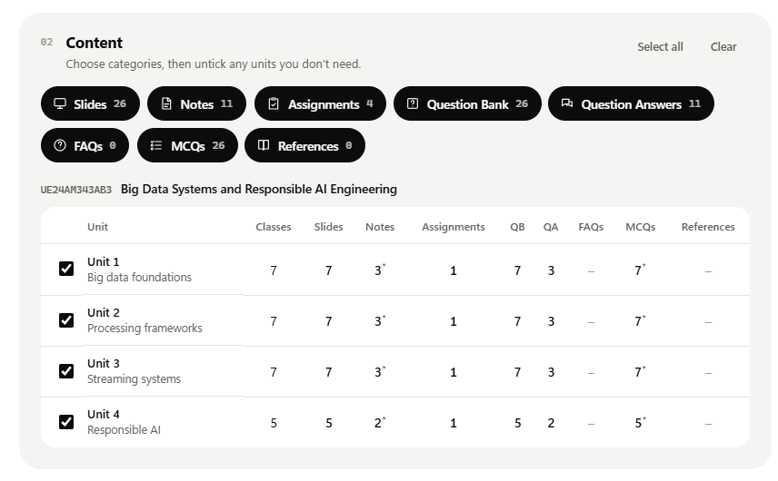
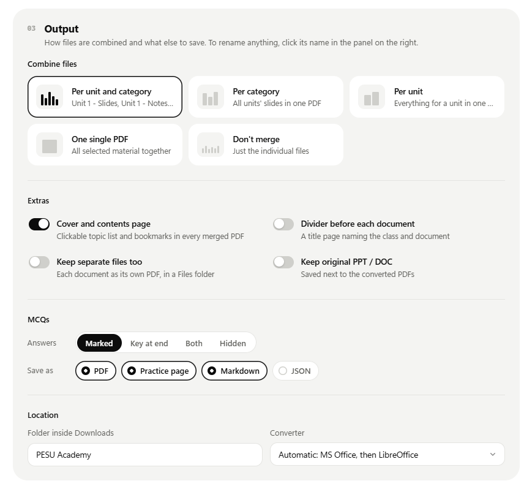
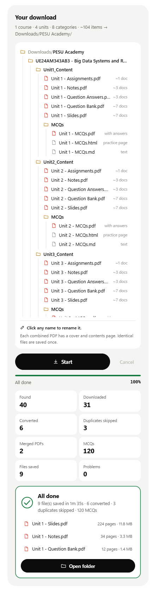
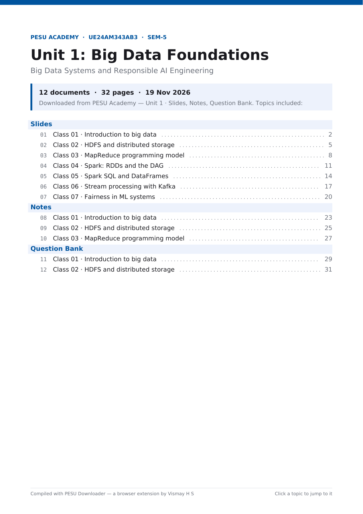

<div align="center">


# PESU Downloader

**Your whole semester from [PESU Academy](https://www.pesuacademy.com), neatly in one folder.**

Download slides, notes, question banks and MCQs unit by unit. Convert everything to PDF, combine it into bookmarked PDFs and get the MCQs with their answers. One click.

Made by **Vismay H S**

[](https://github.com/VismayHS/Pesu_Merger/stargazers)
&nbsp;

&nbsp;


</div>

> [!TIP]
> **Did this save you time? Please ⭐ star the repository** ([click here](https://github.com/VismayHS/Pesu_Merger), then press **Star** at the top right). It's free, takes one second, and helps other PES students find the tool.

<p align="center">
  
</p>

---

## Contents

- [What you get](#what-you-get) · [Before you start](#before-you-start)
- [Install (about 5 minutes)](#install-about-5-minutes): [1. Download](#1-download-pesu-downloader) · [2. Add to browser](#2-add-it-to-your-browser) · [3. Run the installer](#3-run-the-installer) · [4. Check](#4-open-it-and-check)
- [How to use it](#how-to-use-it) · [What the PDFs look like](#what-the-pdfs-look-like) · [Options](#options)
- [Privacy](#privacy) · [Troubleshooting](#troubleshooting) · [Help and contact](#help-ideas-and-contact) · [For developers](#for-developers) · [Credits](#credits)

---

## What you get

A tidy folder in your **Downloads**, with one folder per course and one folder per unit:

```text
Downloads/
└── PESU Academy/
    └── UE24AM343AB3 - Big Data Systems and Responsible AI Engineering/
        ├── Unit1_Content/
        │   ├── Unit 1 - Slides.pdf            ← all of Unit 1's slides, in class order
        │   ├── Unit 1 - Notes.pdf
        │   ├── Unit 1 - Question Bank.pdf
        │   ├── MCQs/
        │   │   ├── Unit 1 - MCQs.pdf          ← questions with the answers marked
        │   │   ├── Unit 1 - MCQs.html         ← interactive practice page
        │   │   └── Unit 1 - MCQs.md
        │   └── Files/                         ← only if you ask for separate files
        │       └── Slides/01 - Introduction to big data.pdf
        ├── Unit2_Content/
        │   └── …
        └── _Report.txt                        ← what was saved, and anything that failed
```

- **Any file type** (PPTX, DOCX, XLSX, images, text…) becomes PDF.
- **Combined PDFs** with a clickable contents page and bookmarks.
- **MCQs with answers**, as a PDF or an interactive practice page.
- **No duplicates**, and **it doesn't give up**: if your session expires or the internet drops, it waits and carries on.

---

## Before you start

**No coding needed.** You don't need git, a GitHub account or anything installed beforehand.

| You need | Notes |
|---|---|
| 💻 **A laptop or desktop** with Windows, macOS or Linux | Phones and tablets can't run extensions like this. |
| 🌐 **Chrome, Edge, Brave, Firefox, Vivaldi or Arc** | Windows already has Edge. **Safari isn't supported** (Apple only allows paid, Xcode-built Safari extensions), so on a Mac use Chrome or Firefox. |
| 🔑 **Your PESU Academy login** | Log in to pesuacademy.com in the browser you add the extension to. |
| ⏱️ **About 5 minutes** | Longer if the installer has to download Python or LibreOffice (LibreOffice is about 350 MB). |

<details>
<summary><b>Never unzipped a file or found your Downloads folder? Read this first.</b></summary>

- **Downloads folder:** on Windows, open **File Explorer** (<kbd>Win</kbd> + <kbd>E</kbd>) and click **Downloads** on the left. On a Mac, open **Finder** and click **Downloads** in the sidebar.
- **Unzipping a ZIP file:** on Windows, right-click it → **Extract All…** → **Extract**. On a Mac, double-click it. Use the folder you get, not the `.zip`.
- **Moving a folder:** drag it onto **Documents** in the sidebar.
- **Typing an address like `chrome://extensions`:** click the bar at the top of the browser where website addresses go, type it exactly and press <kbd>Enter</kbd>.

</details>

---

## Install (about 5 minutes)

Four steps, in order. Works on **Windows, macOS and Linux**.

### 1. Download PESU Downloader

1. Near the top of this page, click the green **`<> Code`** button, then **Download ZIP**.
2. Unzip it ([how?](#before-you-start)). You get a folder called **`Pesu_Merger-main`**.
3. Move that folder into **Documents** and leave it there. The browser loads the extension from this folder, so it stops working if you delete or move it.

Use git? `git clone https://github.com/VismayHS/Pesu_Merger.git` works too.

### 2. Add it to your browser

1. Go to the extensions page: type `chrome://extensions` in the address bar (Chrome, Chromium, Arc). In other browsers it's `edge://extensions`, `brave://extensions` or `vivaldi://extensions`.
2. Turn on **Developer mode** (top-right corner; in Edge it's in the left sidebar). This only lets you add extensions from a folder.
3. Click **Load unpacked**, open `Pesu_Merger-main`, select the **`extension`** folder (the one with `manifest.json` inside) and press **Select Folder**.
4. Click the puzzle-piece icon 🧩 in the toolbar and **pin** PESU Downloader.

Use more than one browser profile? Add the extension in each profile you use PESU in. If the browser later warns about "developer mode extensions", click **Keep**. That's normal for extensions added this way.

#### Using Firefox?

Firefox (version 128 or newer) adds extensions differently:

1. Go to `about:debugging#/runtime/this-firefox` and click **Load Temporary Add-on…**.
2. Open the `extension` folder and pick **`manifest.json`**.
3. If PESU Downloader asks for access to pesuacademy.com, click **Allow access**.

Firefox removes temporary add-ons when it closes, so repeat this each time you start Firefox (about 10 seconds). Chrome, Edge and Brave keep it installed.

### 3. Run the installer

Most courses share slides as PowerPoint and notes as Word files. The installer sets up what turns them into PDF:

- It checks for **Python** and for **Microsoft Office or LibreOffice**. If one is missing, it asks *"Install it now? [Y/n]"*. Press <kbd>Enter</kbd> and it installs it for you. LibreOffice is free.
- It connects the extension to every supported browser on your computer, Firefox included, and tests that it works.

<details open>
<summary><b>🪟 Windows</b></summary>

1. Open `Pesu_Merger-main` → **`native-host`** and **double-click `install.bat`**.
2. If it says *"Windows protected your PC"*, click **More info** → **Run anyway**.
3. If it asks to install Python or LibreOffice, press <kbd>Enter</kbd>. When Windows asks *"Do you want to allow this app to make changes?"*, click **Yes**.

</details>

<details>
<summary><b>🍎 macOS</b></summary>

1. Open **Terminal**: press <kbd>⌘</kbd> + <kbd>Space</kbd>, type **Terminal** and press <kbd>Enter</kbd>.
2. Type `bash` and a space. Then drag **`install.sh`** from the `native-host` folder into the Terminal window and press <kbd>Enter</kbd>.

It installs anything missing, with Homebrew if you have it, otherwise straight from the official websites (it checks they're genuine first, and asks for your Mac's password). Already downloaded LibreOffice but never installed it? It finds the file in Downloads and installs it. On a Mac the converter always uses LibreOffice, even if you have Microsoft Office.

</details>

<details>
<summary><b>🐧 Linux</b></summary>

From the project folder, run `bash native-host/install.sh`. It installs what's missing with apt, dnf, pacman or zypper, and asks for your password first. Snap or Flatpak browsers can't start local helpers, so use the `.deb`/`.rpm` build of Chrome, Brave or Edge.

</details>

Wait until it says **ALL SET!** If it says **NOT FINISHED**, it tells you exactly what's still missing. Do that, then run the installer again.

<details>
<summary>Prefer to install Python and LibreOffice yourself?</summary>

- **Python:** [python.org/downloads](https://www.python.org/downloads/). On Windows, tick **"Add python.exe to PATH"** on the first screen, and don't use the Microsoft Store version.
- **LibreOffice:** [libreoffice.org/download](https://www.libreoffice.org/download/download-libreoffice/). On a Mac, choose Apple Silicon for an M chip or x86_64 for Intel, then open the downloaded file and **drag LibreOffice into Applications** (downloading alone isn't enough). On Windows, an installed Microsoft Office works too (Office in the browser doesn't).
- **Linux:** `sudo apt install python3 libreoffice` (Fedora: `sudo dnf install python3 libreoffice`).

Then run the installer anyway, because it's what connects the extension.

</details>

> Updated PESU Downloader or moved its folder? Run the installer again. To remove the converter, run `native-host\uninstall.bat` (Windows) or `bash native-host/uninstall.sh` (macOS/Linux).

### 4. Open it and check

1. **Restart your browser** completely. On a Mac, quit it with <kbd>⌘</kbd> + <kbd>Q</kbd>: closing the window isn't enough.
2. Open **PESU Downloader** with its toolbar icon.
3. The top-right corner should say **Converter: MS Office** or **Converter: LibreOffice**. 🎉 You're ready: see [How to use it](#how-to-use-it).

If a banner says **Set up the converter** or **Install LibreOffice**, press **Re-check**, or see [Troubleshooting](#troubleshooting). If you press **Start** before the converter is ready, the extension warns you first.

---

## How to use it

1. **Log in** to [pesuacademy.com](https://www.pesuacademy.com) and open the extension: click its icon, or the **⬇ PESU Downloader** button on PESU pages.
2. **Courses:** pick a semester, tick your courses and press **Scan courses**.
3. **Content:** pick the categories (Slides, Notes, Question Bank, MCQs…) and untick any units you don't need.

   

4. **Output:** choose how files are combined ([options](#options)).

   

5. The **Your download** panel on the right shows exactly what you'll get. **Click any name there to rename it.**
6. Press **Start**, keep the tab open until it says **All done**, then press **Open folder**.

<p align="center"></p>

Renaming: **Enter** saves, **Esc** cancels, **↺** brings back the automatic name. The styles under the name field rename every item of that kind at once.

### While it runs

<p align="center">
  
  &nbsp;&nbsp;
  
</p>

- **Cancel** stops cleanly and keeps everything saved so far.
- If your **session expires**, log in again on any PESU tab and it **continues by itself**. If the internet drops or PESU is slow, it waits and retries.
- The **Activity** tab has the full log, with a "Problems" filter.

---

## What the PDFs look like

Every combined PDF starts with a cover page listing every topic. **Click a topic to jump to it**; the same list is in the bookmarks sidebar.

<p align="center">
  
</p>

**MCQs** are saved in each unit's `MCQs` folder, with the correct answers from the portal:

| PDF (answers marked) | Practice page (click an answer to check it) |
|---|---|
|  |  |

---

## Options

| Option | What it does |
|---|---|
| **Combine** | Per unit and category *(default)*: `Unit 1 - Slides.pdf`. Or per category (`Slides - Units 1-4.pdf`), per unit (`Unit 1 - Complete.pdf`), one single PDF, or don't merge |
| **Cover and contents page** | The clickable topic list at the start of each combined PDF |
| **Divider before each document** | A title page before each document, naming its class |
| **Keep separate files too** | Also saves each document as its own PDF in `UnitN_Content/Files/` |
| **Keep original PPT / DOC** | Keeps the original Office files next to the PDFs |
| **MCQ answers / formats** | Answers marked, as a key at the end, both or hidden; saved as PDF, practice page, Markdown or JSON |
| **Folder / converter** | The main folder's name (default `PESU Academy`); which converter to use (automatic by default) |

Options that don't apply to your choice are greyed out.

---

## Privacy

Everything happens in your browser and on your own computer, using your existing PESU login. The extension talks **only** to `pesuacademy.com` and `files.pesuacademy.com`: no analytics, no servers, and it never touches your password.

<details>
<summary>Why each permission is needed</summary>

| Permission | Why |
|---|---|
| `pesuacademy.com`, `files.pesuacademy.com` | Read course pages and download files with your login |
| `downloads`, `downloads.ui` | Save files into Downloads (the download bubble is hidden during a run) |
| `scripting`, `webRequest` | Backup route: fetch through your open PESU tab if direct requests are blocked |
| `nativeMessaging` | Talk to the converter helper on your computer |
| `storage`, `unlimitedStorage` | Remember your settings and handle large files |

</details>

---

## Troubleshooting

<details>
<summary><b>"Set up the converter", "Converter didn't start" or "Install LibreOffice" keeps showing</b></summary>

- Run the installer again ([step 3](#3-run-the-installer)). **ALL SET!** means it worked: restart the browser completely (⌘Q on a Mac) and press **Re-check**. **NOT FINISHED** tells you what's missing.
- To see what it would do without changing anything: `native-host\install.bat -DryRun` (Windows) or `bash native-host/install.sh --dry-run` (macOS/Linux).
- macOS: LibreOffice must be in `/Applications`. Linux: Snap/Flatpak browsers can't run helpers, so use the `.deb`/`.rpm` build.

</details>

<details>
<summary><b>"Log in to PESU Academy" keeps showing</b></summary>

Log in at pesuacademy.com **in the same browser and profile**. The extension notices within a few seconds, or press **Continue**.

</details>

<details>
<summary><b>The button on pesuacademy.com doesn't respond</b></summary>

If it says **↻ Refresh page to use PESU Downloader**, click it once. The toolbar icon always works too.

</details>

<details>
<summary><b>A file failed to convert</b></summary>

The original is saved instead and listed in `_Report.txt`. The helper's log is in `%LOCALAPPDATA%\PESUDownloader\host.log` (Windows), `~/Library/Application Support/PESUDownloader/host.log` (macOS) or `~/.cache/pesu-downloader/host.log` (Linux).

</details>

<details>
<summary><b>Updating, or Firefox lost the extension</b></summary>

- **Update:** download the new code (or `git pull`), press **reload ↻** on the extension's card in `chrome://extensions` (in Firefox, **Reload** on the `about:debugging` page), and run the installer again.
- **Firefox:** it removes temporary add-ons when it closes. Load it again ([how](#using-firefox)).

</details>

---

## Help, ideas and contact

| | How |
|---|---|
| 🐞 **Something isn't working** | [Open a bug report](https://github.com/VismayHS/Pesu_Merger/issues/new?template=bug_report.yml). Paste the **Activity** log (Activity tab → **Copy**) and say which browser and OS you use. |
| 💡 **Idea or feature request** | [Suggest a feature](https://github.com/VismayHS/Pesu_Merger/issues/new?template=feature_request.yml), or 👍 an [existing issue](https://github.com/VismayHS/Pesu_Merger/issues) |
| ✉️ **Prefer email?** | Write to **[vismayhs@gmail.com](mailto:vismayhs@gmail.com)** |

Please never share your PESU password or SRN in an issue.

---

## For developers

| Path | Role |
|---|---|
| `extension/app.html`, `app.css`, `app.js` | The downloader page: UI, naming and rename, preview, job pipeline, dedupe, session watchdog |
| `extension/src/pesu.js`, `net.js` | Portal parsers; fetching with session detection, retries and fallback routes |
| `extension/src/pdf.js`, `mcq.js` | Merging (pdf-lib), cover page, bookmarks, MCQ PDF and the HTML / Markdown / JSON exports |
| `extension/src/native.js` | Native-messaging client for the helper |
| `native-host/pesu_host.py` | The helper (standard library only): MS Office COM on Windows, LibreOffice everywhere |
| `native-host/install.*`, `uninstall.*`, `selftest.py` | Setup: installs missing Python / LibreOffice (on a Mac without Homebrew, from the official sites after checking signatures), copies the helper out of the project folder on macOS/Linux, registers it, tests it. `-DryRun` / `--dry-run`, `-Yes` / `--yes` |

```bash
node tests/host_test.js <folder with office files>          # helper test (run the installer first)
npm install --no-save pdf-lib@1.17.1 @pdf-lib/fontkit@1.1.1
node tests/pdf_test.js <folder with PDFs + tiny.png> <out>  # PDF engine test
```

The extension ID is fixed (`cooigkfjkkbolfcfcdmbmdjpmbmlofab`, from the key in `manifest.json`); the helper relies on it.

---

## Credits

Built by **Vismay H S**. Bundles [pdf-lib](https://github.com/Hopding/pdf-lib) (MIT), [@pdf-lib/fontkit](https://github.com/Hopding/fontkit) (MIT) and the DejaVu fonts (see `extension/fonts/LICENSE-DejaVu.txt`).

An unofficial student tool, not affiliated with PES University. Use it only for material your account has access to.

<div align="center">

**If PESU Downloader helped you, please [⭐ star the repo](https://github.com/VismayHS/Pesu_Merger) and share it with your classmates!**

</div>
